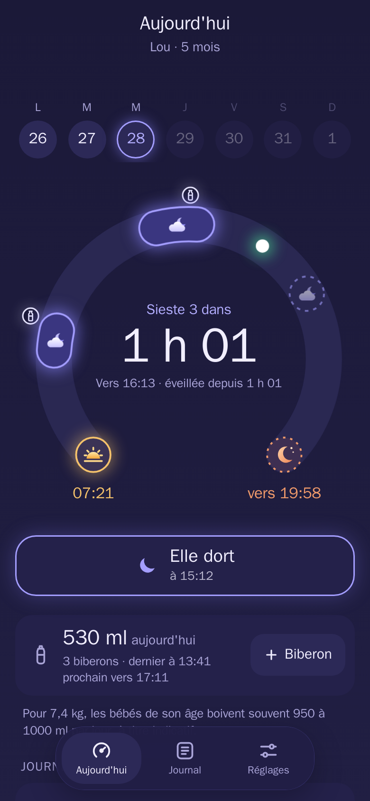
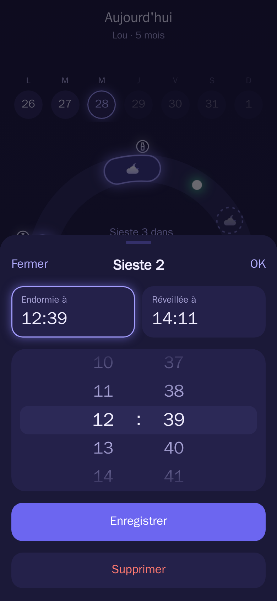
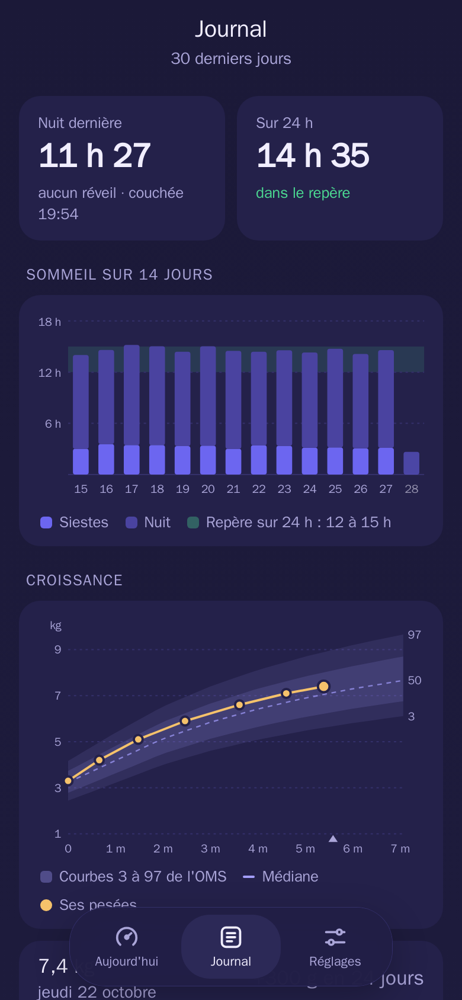
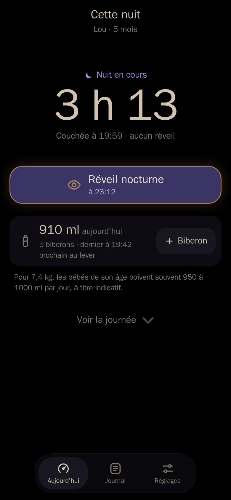

# Roupillon

<p align="center">
  
</p>

**Self-hosted baby nap tracker that predicts the next nap.**
*Suivi et prévision des siestes de bébé, à héberger soi-même.*

<p align="center">
  
  
  
  
</p>

[English](#english) · [Français](#français)

---

## English

*Roupillon* is French slang for "a little nap".

Roupillon is a small mobile web app for two parents. One tap logs when the baby falls asleep, wakes up or has a bottle. The app predicts the next nap and bedtime.

### Features

#### The day
- **A day dial** - from wake-up to bedtime, with past and upcoming naps, bottles and the current time
- **One tap to log** - asleep, awake, bottle; tap a nap or a bottle to correct its time
- **Night mode** - after bedtime, a dimmed screen in warm colors, with the night's length and night wakings

#### Predictions
- **Based on exact age** - starting points follow the baby's age, to the day
- **They learn** - they adapt to the last two weeks (wake windows, length of each nap, last wake window, bedtime)
- **Bottles** - daily milk total and time of the next bottle, with none announced overnight

#### Tracking
- **A journal** - the last 30 days, with 14 days of sleep against the guide for the baby's age
- **Growth** - weigh-ins plotted on the WHO growth charts (0 to 2 years, girls or boys)
- **A milk guide** based on weight up to 6 months, as a rough guide only

#### Built for two
- **One account per parent** - each sees the other's entries as soon as they open the app
- **iPhone** - lock-screen widget (through the Scriptable app) and Siri shortcuts to log without opening the app

#### App & security
- **PWA** - installable on the phone's home screen
- **Offline** - taps are kept on the phone with their real time and sent once the network is back
- **Two themes** - night blue, or light and dark following the phone
- **Daylight saving time** handled
- **Backup** of the database every night (7 copies kept)
- **Protected login** - rate-limited, passwords of at least 12 characters
- **First-run setup** - no config file needed, just open the app

**The interface is in French only for now.**

### Quick Start

#### 1. Build the image

You need Docker. The image is built from this repository:

```sh
git clone https://github.com/ninidas/roupillon.git
cd roupillon
docker build -t roupillon:latest .
```

#### 2. Create a `docker-compose.yml`

```yaml
services:
  roupillon:
    image: roupillon:latest
    container_name: roupillon
    restart: unless-stopped
    environment:
      - PUID=1000
      - PGID=1000
      - TZ=Europe/Paris
      - APP_TZ=Europe/Paris
    volumes:
      - ./data:/data
    ports:
      - "8000:8000"
```

Then run `docker compose up -d`.

#### 3. First run

Open `http://<your-server>:8000` on your phone. The app asks for the baby's first name and birth date, then one or two parent accounts. On iPhone, *Share* then *Add to Home Screen* installs it like a native app.

To reach it away from home, put it behind an HTTPS reverse proxy or a VPN.

### Widget and Siri

In *Réglages* (Settings), create your personal key. The app then gives you the widget script for Scriptable and explains the Siri shortcuts. These call `/api/quick/toggle` (start or stop a nap) and `/api/quick/feed` (bottle), with the key in the `X-Roupillon-Key` header.

### Configuration

All variables are optional.

| Variable | Default | Purpose |
| --- | --- | --- |
| `DB_PATH` | `/data/roupillon.db` | SQLite database location |
| `APP_TZ` | `Europe/Paris` | Time zone used for days |
| `SECRET_KEY` | generated and stored in the database | Session signing key |
| `TRUSTED_PROXIES` | private addresses | Proxies whose forwarded address is trusted |
| `NIGHTLY_BACKUP` | `1` | `0` turns off the nightly database copy to `/data/backup` |
| `PUID` / `PGID` | `0` | Owner of `/data` |

### Development

```sh
docker compose -f docker-compose.dev.yml up -d --build    # http://127.0.0.1:8007
docker run --rm --tmpfs /data --entrypoint sh roupillon:dev -c 'python -m pytest -q tests'
```

### Disclaimer

Roupillon helps you get organized; it is not medical advice. Sleep and milk guides are averages, and every baby has their own rhythm. If in doubt, ask your pediatrician.

---

## Français

*Roupillon* veut dire « petite sieste » en français familier.

Roupillon est une petite appli web pour téléphone, pensée pour deux parents. On note d'un toucher quand bébé s'endort, se réveille ou boit un biberon. L'appli prévoit la prochaine sieste et l'heure du coucher.

### Ce qu'elle fait

#### La journée
- **Un cadran de la journée** : du lever au coucher, siestes faites et prévues, biberons et heure qu'il est
- **Un toucher pour noter** : endormi, réveillé, biberon ; on touche une sieste ou un biberon pour corriger l'heure
- **La nuit** : après le coucher, écran tamisé aux couleurs chaudes, durée de la nuit et réveils nocturnes

#### Les prévisions
- **Selon l'âge exact** : les repères de départ suivent l'âge du bébé, au jour près
- **Qui apprennent** : elles s'ajustent à ses deux dernières semaines (temps d'éveil et durée de chaque sieste, dernier éveil, heure du coucher)
- **Les biberons** : total de lait du jour et heure du prochain biberon, sans en annoncer la nuit

#### Le suivi
- **Un journal** : les 30 derniers jours, le sommeil sur 14 jours face au repère de son âge
- **La croissance** : pesées placées sur les courbes de l'OMS (0 à 2 ans, fille ou garçon)
- **Un repère de lait** selon le poids jusqu'à 6 mois, donné comme un simple ordre de grandeur

#### À deux
- **Un compte par parent** : chacun voit ce que l'autre a noté dès qu'il ouvre l'appli
- **iPhone** : widget d'écran verrouillé (avec l'app Scriptable) et raccourcis Siri pour noter sans ouvrir l'appli

#### Appli et sécurité
- **PWA** : s'installe sur l'écran d'accueil du téléphone
- **Hors connexion** : les gestes sont gardés sur le téléphone avec leur heure réelle, puis envoyés au retour du réseau
- **Deux thèmes** : bleu nuit, ou clair et sombre selon le téléphone
- **Changement d'heure** pris en compte
- **Sauvegarde** de la base chaque nuit (7 gardées)
- **Connexion protégée** : essais limités, mot de passe de 12 caractères au moins
- **Installation guidée** : aucun fichier de configuration, il suffit d'ouvrir l'appli

L'appli est en français uniquement.

### Installation

Il faut Docker. Construisez l'image depuis ce dépôt, puis lancez-la avec le `docker-compose.yml` de la [partie anglaise](#quick-start) (`docker compose up -d`).

Ouvrez ensuite `http://<votre-serveur>:8000` sur le téléphone. L'appli demande le prénom et la date de naissance du bébé, puis un ou deux comptes de parents. Sur iPhone, *Partager* puis *Sur l'écran d'accueil* l'installe comme une vraie appli.

Pour y accéder hors de chez vous, placez-la derrière un proxy inverse en HTTPS ou un VPN.

### Widget et Siri

Dans *Réglages*, créez votre clé personnelle. L'appli donne alors le script du widget à coller dans Scriptable et explique les raccourcis Siri. Ceux-ci appellent `/api/quick/toggle` (sieste qui commence ou s'arrête) et `/api/quick/feed` (biberon), avec la clé dans l'en-tête `X-Roupillon-Key`.

### Réglages

Toutes les variables sont facultatives ; voir le tableau de la [partie anglaise](#configuration).

### Avertissement

Roupillon aide à s'organiser ; ce n'est pas un avis médical. Les repères de sommeil et de lait sont des moyennes, et chaque bébé a son rythme. En cas de doute, demandez à votre pédiatre.

---

## Tech Stack

- **Frontend** - React, Vite, PWA
- **Backend** - FastAPI, SQLAlchemy, SQLite, Uvicorn
- **Auth** - JWT (python-jose), bcrypt, rate limiting (slowapi)
- **iPhone** - Scriptable widget and Siri Shortcuts
